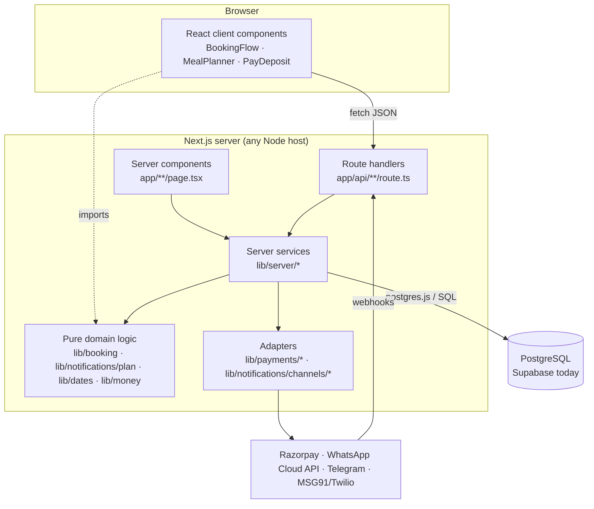

# Architecture

## Goals
1. **Portable** — runs on any Node host + any Postgres. Vercel and Supabase are today's hosts, not dependencies.
2. **Extensible** — payments, notification channels, invoicing and auth are behind small interfaces; adding a provider never touches booking logic.
3. **Correct by construction** — invariants (no double-booking, idempotent payments, price snapshots) are enforced in the database or a single module, not scattered in UI code.
4. **Configurable** — business rules live in the `settings` table with typed defaults in code; secrets live in env.

## Layers



| Layer | Folder | Rules |
|---|---|---|
| Pure domain | `src/lib/booking`, `src/lib/dates.ts`, `src/lib/money.ts`, `src/lib/settings.ts`, `src/lib/notifications/{plan,templates,context,config,types}.ts` | No I/O, no `server-only`. Imported by both client (live price preview) and server (authoritative). Unit-tested. |
| Server services | `src/lib/server/*` | Import `server-only`. Own all DB access and side effects. Recompute every price server-side — never trust the client. |
| Adapters | `src/lib/payments/*`, `src/lib/notifications/channels/*` | One file per external provider, implementing a small interface. Activate when env credentials exist. |
| HTTP | `src/app/api/**` | Thin: parse with zod → call a service → `errorResponse()`. |
| UI | `src/app/**/page.tsx`, `src/components/**` | Server components load data; client components handle interaction. Styling only via theme tokens. |

## Module map

```
src/
  app/
    page.tsx                       landing
    book/page.tsx                  booking flow (server loads rooms+settings)
    booking/[token]/page.tsx       guest's private manage page
    api/availability/…             room availability, calendar
    api/bookings                   create booking
    api/manage/[token]/meals|pay   guest meal edit, start deposit checkout
    api/payments/[provider]/verify browser payment callback
    api/webhooks/razorpay          provider webhook
    api/cron/daily|notifications   scheduled jobs (Bearer CRON_SECRET)
  auth.ts                          Auth.js config (Google; phone OTP planned)
  app/signin|account|admin         sign-in, guest bookings, staff area
  content/site.ts                  marketing copy + placeholder photos
  components/fx                    animation primitives (carousels, reveal, spotlight, marquee…)
  components/home                  landing page sections
  components/site                  header, footer, auth server actions
  components/ui                    Button, Card, Field, Stepper
  components/booking               DateRangeCalendar, RoomCard, MealPlanner, PriceSummary, BookingFlow, ManageMeals, PayDeposit
  lib/
    booking/{meals,pricing,rules,schemas}.ts   domain rules (pure)
    notifications/                 event types, config schema, templates, delivery planner, channels/
    payments/                      PaymentProvider interface, razorpay adapter, registry
    server/                        db, repos, bookings, payments, notify, daily-jobs, cron, http
    settings.ts                    typed settings schema + defaults
    theme.ts                       theme → CSS variables
  theme/theme.config.ts            design tokens
db/migrations/*.sql                append-only schema history
```

## Key flows

### Booking
1. `/book` server component loads rooms + settings; `BookingFlow` computes a live quote client-side using the same pure `planMeals` + `computeQuote` the server uses.
2. `POST /api/bookings` → `createBooking()` validates stay/occupancy/meals, recomputes the quote, inserts `bookings` + `booking_rooms` + `booking_meals` in one transaction. The exclusion constraint rejects overlaps (→ 409).
3. Status is `pending` with a hold (`expires_at`) if online payment is active, else `confirmed`. A `booking.pending` / `booking.confirmed` notification fires.

### Deposit payment
See [payments.md](payments.md). Browser callback and webhook both call the idempotent `recordPayment()`; whichever arrives first confirms the booking.

### Notifications
`notify(event, {booking, vars, dedupeKey})` → `planDeliveries()` (pure: routes × recipients × templates) → rows in `notifications` → channel adapters send → row updated. Never throws. See [notifications.md](notifications.md).

## Extension points

| To add… | Do this |
|---|---|
| A payment provider (Stripe, Cashfree…) | Implement `PaymentProvider` in `lib/payments/<name>.ts`, register in `lib/payments/index.ts`, add a webhook route. |
| A notification channel (email, push, Slack…) | Add the name to `CHANNELS` in `notifications/types.ts`, implement `NotificationChannel` in `channels/<name>.ts`, register in `channels/index.ts`. |
| A notification event | Add to `NOTIFICATION_EVENTS`, add default templates + routes, call `notify()` where it happens. |
| A business setting | Add a field (with default) to the zod schema in `lib/settings.ts`; it's immediately readable via `getSettings()`. |
| A schema change | New file `db/migrations/NNNN_description.sql`; never edit applied migrations. |
| External invoicing (Frappe Books…) | Planned `InvoiceProvider` interface fed from `bookings` + `booking_rooms` + `booking_meals` + `payments` (all carry price and GST snapshots). |
| A sign-in method (phone OTP, email link…) | Add an Auth.js provider in `src/auth.ts` and call `upsertIdentityUser()`; see [auth.md](auth.md). |
