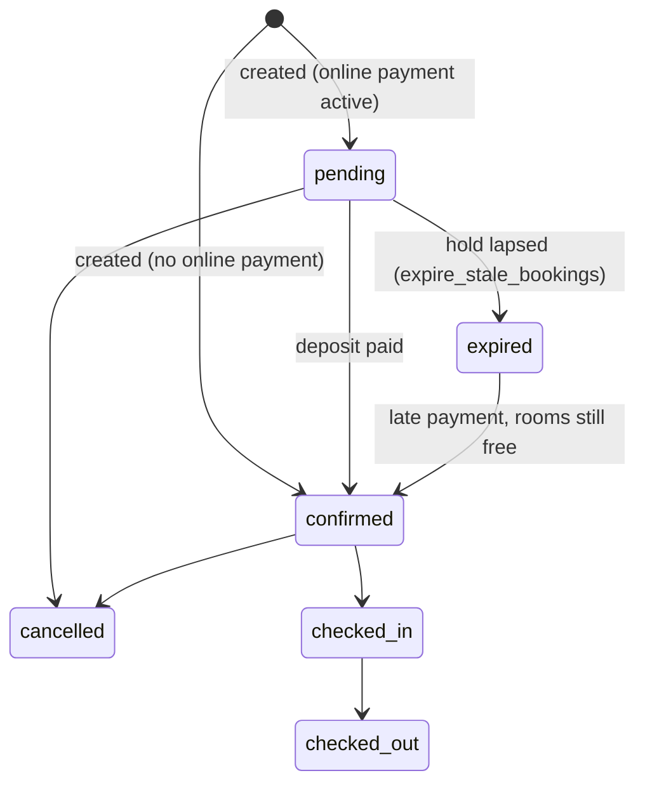

# Booking & pricing rules

All rules are implemented in pure functions (`src/lib/booking/*`) shared by the client preview and the server, and covered by `src/lib/booking/booking.test.ts`. Values in *italics* are settings ([configuration.md](configuration.md)).

## Dates & stays
- Calendar dates are `YYYY-MM-DD` strings (`ISODate`), never JS `Date`s. Wall-clock times are interpreted in *property.timezone* (default `Asia/Kolkata`).
- A stay check-in → check-out covers **nights** check-in … check-out−1 (half-open range `[check_in, check_out)`).
- Same-day turnover is allowed: one booking's check-out date can be the next booking's check-in.
- Check-in cannot be in the past (property timezone) or more than *booking.maxAdvanceDays* (365) ahead.
- Stay length between *booking.minNights* (1) and *booking.maxNights* (30).
- Check-in/out times (*booking.checkInTime* 14:00 / *checkOutTime* 11:00) are informational.

## Rooms & occupancy
- A booking can contain **several rooms**, all on the same dates.
- Each selected room gets a guest count between 1 and its `max_occupancy`. `num_guests` = sum.
- Children count toward occupancy like adults (no child policy yet).
- **No double-booking** is enforced in Postgres by an exclusion constraint on `(room_id, stay)` for rows where `blocks_inventory` is true. Statuses `pending`, `confirmed`, `checked_in`, `checked_out` block; `cancelled`, `expired` don't.

## Meals
| Meal | Dates offered | Default |
|---|---|---|
| Breakfast | Morning **after** each night: check-in+1 … check-out | Included: quantity = guests, ₹0, `included_free = true` |
| Lunch | Each day with a booked night: check-in … check-out−1 | 0, guest picks headcount |
| Dinner | Each night: check-in … check-out−1 | 0, guest picks headcount |

- Headcount per meal: integer 0 … `num_guests`.
- If *meals.breakfastIncluded* is false, breakfast becomes a paid optional meal at *meals.breakfastPrice*. An existing booking's included-breakfast rows stay included if the setting later changes.
- Breakfast rows exist even though they're free, so the kitchen has counts.
- Only rows with quantity > 0 are stored.

### Edit cutoff
- Each meal on date D locks at *meals.cutoffTime* (18:00) on D − *meals.cutoffDaysBefore* (1), in property time.
- The cutoff applies at **booking time too** (a same-day booking can't add tonight's dinner).
- Locked meals keep their quantity; attempting to change one is a validation error.
- Admin edits will pass `bypassCutoff`.

### Price snapshots
- Each `booking_meals` row stores `price_at_booking` and `gst_rate` when first added. Editing quantity keeps that price; newly added meals use current prices.
- `booking_rooms` stores `price_per_night` and `gst_rate` at booking.

## Pricing
- All entered prices are **exclusive of GST**. Money is integer **paise** in code, `numeric(12,2)` rupees in the DB.
- Room charge = `price_per_night × nights` per room.
- Meal charge = `unit price × quantity` per row (₹0 when included).
- **GST** per line, rounded to the paisa:
  - Rooms: *tax.roomRateLow* (5%) when nightly tariff ≤ *tax.roomThreshold* (₹7,500), else *tax.roomRateHigh* (18%).
  - Food: *tax.foodRate* (5%).
  - Displayed as CGST + SGST halves when *tax.intraState*, else IGST.
  - ⚠️ Confirm rates with a CA before going live.
- Total = subtotal + tax.

## Deposit & balance
- Deposit = *deposit.value*% of the total incl. GST (*deposit.type* `percent`), or a fixed ₹ amount (`fixed`), **rounded up to the whole rupee**, never more than the total.
- Before the deposit is paid, the deposit follows the total (e.g. after meal edits). Once paid, it's fixed.
- Balance = total − deposit, settled at the property (admin marks paid — upcoming).

## Booking status lifecycle

- Holds last *booking.holdMinutes* (15). Starting checkout extends the hold by the same amount.
- `expire_stale_bookings()` runs before every availability check, booking creation and in the daily cron.
