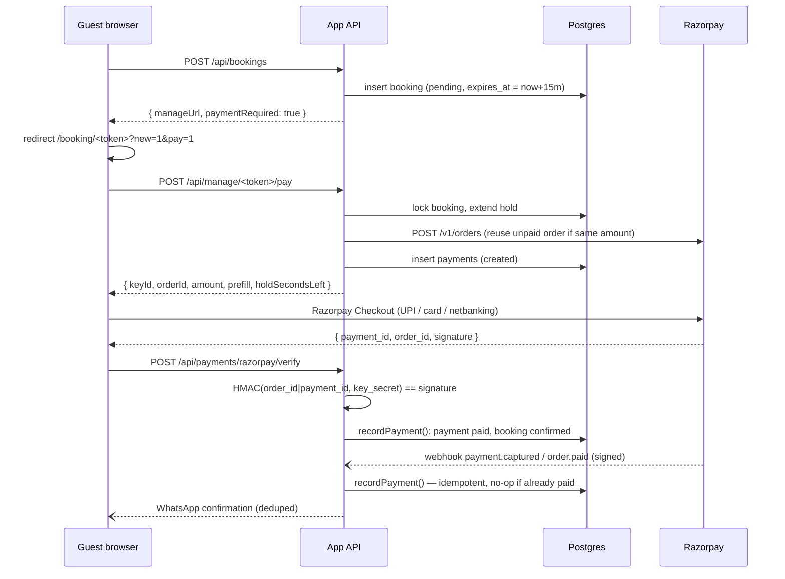

# Payments (Razorpay deposits)

## Overview
- At booking, the guest pays a **deposit** online (configurable % or fixed amount — see [booking-rules.md](booking-rules.md)).
- The **balance** is settled at the property and marked paid by staff (admin dashboard — upcoming; will write a `payments` row with `provider = 'manual'`).
- Online payment is active only when **both** `settings.booking.paymentsEnabled` is true **and** a provider is configured (`RAZORPAY_KEY_ID` + `RAZORPAY_KEY_SECRET`). Otherwise bookings are confirmed immediately and staff collect the deposit offline.

## Flow

## Guarantees
- **Idempotent**: `recordPayment()` locks the payment row; repeated callbacks/webhooks return `already_paid`. Notifications use a `dedupe_key`, so the guest gets one confirmation.
- **Never trust the browser**: amounts come from the DB; the browser callback is accepted only with a valid HMAC signature; the webhook is verified with `RAZORPAY_WEBHOOK_SECRET`.
- **Webhook is the source of truth**: if the guest closes the tab after paying, the webhook still confirms the booking.
- **Retry-friendly**: an unpaid `created` order for the same amount is reused, so retries don't create order spam. Failed attempts record `failure_reason`; the guest can retry.

## Edge cases
| Situation | Behaviour |
|---|---|
| Hold expires while guest is on checkout | Checkout `timeout` is set to the remaining hold; starting checkout extends the hold. |
| Payment arrives after hold expired, room still free | Booking re-confirmed (`expired → confirmed`). |
| Payment arrives after hold expired, room taken | Payment marked `conflict`, booking note added, `payment.conflict` alert to operator → **refund manually** in Razorpay dashboard. |
| Razorpay down / bad keys | `/pay` returns 502 with a friendly message; details logged server-side. |
| Deposit already paid | `/pay` returns 423. |
| Meal edits after deposit paid | Total changes; deposit stays fixed; balance absorbs the difference. |

## Setup
> Owner checklist with screenshots-level detail: [razorpay-onboarding.md](razorpay-onboarding.md).

1. Razorpay Dashboard → **Account & Settings → API Keys** → generate **Test** keys.
2. Set env: `RAZORPAY_KEY_ID`, `RAZORPAY_KEY_SECRET`.
3. **Settings → Webhooks → Add**: URL `https://<your-domain>/api/webhooks/razorpay`, a secret (→ `RAZORPAY_WEBHOOK_SECRET`), events `payment.captured`, `payment.failed`, `order.paid`.
4. Payment capture: orders are created with `payment_capture: 1` (auto-capture).
5. Test with Razorpay's test UPI id `success@razorpay` or test cards from their docs. Switch to **Live** keys only after KYC and a real test transaction.

Webhooks can't reach `localhost`; locally the browser callback confirms payment. To test webhooks locally use a tunnel (e.g. `cloudflared tunnel --url http://localhost:3000`) or send a signed request yourself (see `src/lib/payments/razorpay.test.ts` for the signature format).

## Adding another provider
1. Implement `PaymentProvider` (`src/lib/payments/types.ts`) in `src/lib/payments/<name>.ts`.
2. Register it in `src/lib/payments/index.ts`; select with `PAYMENT_PROVIDER=<name>`.
3. Add `src/app/api/webhooks/<name>/route.ts` that calls `recordPayment()` / `recordPaymentFailure()`.
4. Add a client checkout component (like `PayDeposit.tsx`) if the provider's checkout differs.
